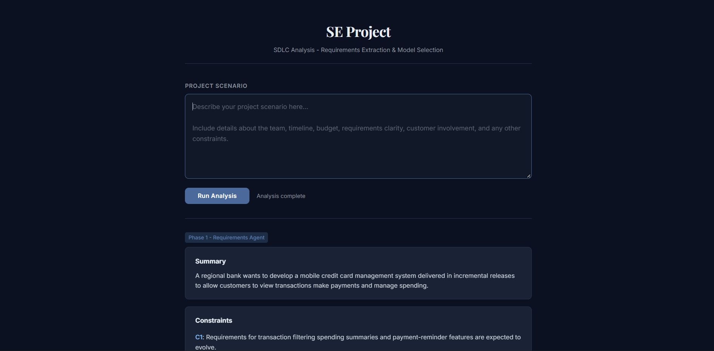

# AI-Powered SDLC & Requirements Analysis

[](LICENSE)
[](https://nodejs.org/)
[](https://mastra.ai)
[](https://lmstudio.ai)
[](https://www.typescriptlang.org/)

This project is an advanced, local-first requirements engineering and Software Development Life Cycle (SDLC) analysis engine. Designed for software architects, technical product managers and systems engineers, it ingests unstructured project briefs, extracts precise constraints and objectively identifies the optimal development framework based on academic and industry standards.



---

## Overview

Software engineering projects frequently fail due to misaligned methodologies and vague requirements. This tool solves this by utilizing a two-phase AI pipeline that acts as your architecture sparring partner:

1. **Requirements Extraction Agent:** Parses raw project scenarios to extract concrete requirements, risks and critical constraints (budget, timeline, team skill, requirements clarity).
2. **SDLC Selection Agent:** Employs rigorous logical mapping against ingested university/industry guidelines to recommend the best-fitting SDLC (e.g., Agile Scrum, RAD, Waterfall, Spiral), providing explicit decision signals and justification.

### Key Capabilities
- **Local Privacy & Inference:** Powered by local Language Models (via LM Studio) and an entirely local RAG index. No project data leaves your machine.
- **RAG-Grounded Intelligence:** Uses Mastra's BM25 search to index files under `docs/ingested/`, guaranteeing that recommendations are strictly based on established engineering literature rather than LLM hallucinations.
- **Minimalist Web UI:** A sleek, formal dark-mode interface designed for high readability and professional reporting.
- **Persistent Analysis:** Generates formatted technical reports in HTML and Markdown for seamless sharing with stakeholders.

---

## Architecture

The project leverages the modern agentic framework [Mastra](https://mastra.ai) combined with an elegant custom frontend:

- **Agent Runtime:** Mastra orchestrates workflows, RAG search and agent state.
- **Frontend UI:** Built with Vanilla HTML/CSS/JS (served via TSX on port 3001) ensuring blazing fast rendering with a premium, corporate aesthetic.
- **Knowledge Base:** Raw `.txt`, `.md` and `.yaml` files placed in `docs/ingested/` are automatically BM25-indexed on boot.
- **Inference Pipeline:** Calls local OpenAI-compatible endpoints (defaulting to LM Studio).

---

## Quick Start

### Prerequisites
- **Node.js** (v22.13.0 or higher)
- **LM Studio** - [Download](https://lmstudio.ai/download) (for local LLM inference)

### 1. Setup Environment
Clone the repository and install dependencies:
```bash
git clone https://github.com/akh7177/SE-Project.git
cd se-project
npm install
```

### 2. Configure Inference
1. Launch **LM Studio** and start the local server on `http://127.0.0.1:1234`.
2. Load a capable reasoning model (e.g., `qwen/qwen3.5-9b` or `llama-3-8b`).
3. Copy the `.env.example` to `.env`:
   ```bash
   cp .env.example .env
   ```
   Ensure the endpoints match your LM Studio setup.

### 3. Add Knowledge base
The system comes pre-loaded with standard SDLC lectures and IEEE-830 templates. To expand its knowledge:
- Drop any plain text `.txt`, `.md` or `.yaml` files into `docs/ingested/`.
- The system automatically indexes these on the next run.

### 4. Run the Application
Launch the web server:
```bash
npm run ui
```
Open `http://localhost:3001` in your browser. Enter a complex software scenario, click **Run Analysis** and review the extracted requirements and chosen SDLC.

---

## Project Structure

```
SE Project/
├── assets/                # Static assets (UI mockups, diagrams)
├── docs/ingested/         # RAG Knowledge base (SDLC lectures, IEEE 830 guides)
├── frontend/              # The minimalist dark-mode Web UI
│   ├── index.html         # Client-side interface
│   └── server.ts          # Express/TSX server routing agent workflows
├── src/mastra/
│   ├── prompts.ts         # Agent instruction templates
│   ├── rag.ts             # BM25 retrieval and context injection
│   ├── finance-agents.ts  # Agent definitions
│   └── workflow.ts        # The two-phase requirements -> SDLC pipeline
└── package.json
```

---

## License
This project is licensed under the MIT License - see the [LICENSE](LICENSE) file for details.
